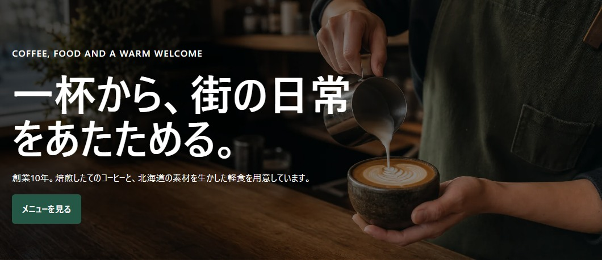
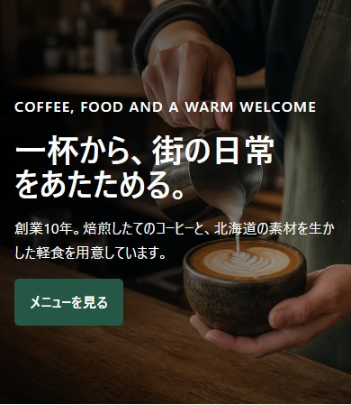

# DAY 9 もっとインパクトのある写真に

[目次](../student-workbook.md) · [共通手順](./common.md#local-git-workflow) · [前の回：DAY 8](./day08.md) · [次の回：DAY 10](./day10.md)

> **店長の佐藤さんからの依頼**  
> 来月のキャンペーンまでに、ホームの写真をもっと印象に残るものにしてください。

**今回の課題:** 初めてサイトを見るお客さんに、お店の魅力が伝わる写真を選びます。  
ホーム上部の背景を変えます。  
文章と「メニューを見る」ボタンはそのまま使います。

**作業前に考えること:** 「コーヒーをいれる様子と店内の雰囲気では、どちらを見せたいですか」と佐藤さんに聞いてみましょう。

**今回学ぶこと:** CSSで背景写真を入れ、画面の幅に合わせて写真の位置を調整します。  
パソコンでもスマホでも、見せたい部分が残り、文字が読めたら完成です。

## 1. 写真を選ぶ

[依頼メール](../../fixtures/emails/02-hero-request.md)を読み、何を見せたいか、文字をどこに置くか、何を写さないかを確認します。  
[AIで作った画像](../../fixtures/photographer-delivery/hero-ai-master.png)と[撮影を想定した練習用画像](../../fixtures/photographer-delivery/simulated-shoot-001.jpg)を比べます。  
**写真のどこを見る？** 最初に目が行くのはどこですか。  
見出しを重ねるなら、どこに置くと読みやすそうですか。  
その答えをもとに写真を選びます。  
[素材台帳](../../fixtures/photographer-delivery/ASSET-MANIFEST.md)で、画像の作られ方と使ってよい範囲を確認します。  
AIで別の案を作ったら、入力した指示（プロンプト）も残します。

選んだ写真をWebPかAVIFに変換して、`hht/day09/images/`に保存します。  
変換前後の形式・縦横のピクセル数・ファイルの大きさをメモします。  
300 KB以下を目安にし、ぼやけていないかも見ます。

## 2. 背景に写真を入れる

[共通の開始手順](./common.md#independent-day-start)で教材を準備します。  
ブラウザで`hht/day09/index.html`を開きます。


**画面のどこを変える？** ①の帯に写真を入れると、②の見出しは写真のどのあたりに重なりそうですか。

VS Codeで`hht/day09/css/style.css`を開き、`.hero`を探します。  
`.hero`の中にある`background`を、次の例のように書き換えます。  
`hero-cafe.webp`の部分には、自分が保存した画像の名前を書きます。

```css
background:
  linear-gradient(90deg, rgb(0 0 0 / 72%), rgb(0 0 0 / 18%)),
  url("../images/hero-cafe.webp");
background-size: cover;
background-position: center;
```

Ctrl+Sで保存し、ブラウザを再読み込みします。

💡 **ヒント：**
> 写真の上に暗い色を重ねると、白い文字が読みやすくなります。  
> `../`は、CSSが入っているフォルダーから一つ上に戻るという意味です。

## 3. パソコンとスマホの幅で見る

DAY 8と同じように、ブラウザの幅を変えます。

**パソコン幅の例**



**スマホ幅の例**



**確認項目:** 2枚を比べると、スマホ幅では写真のどこまで見えますか。  
自分の画面でも、見せたいものが残っていますか。  
見出しは読めますか。  
「メニューを見る」を押すと、メニューページが開きますか。

狭い画面で写真が切れるときは、CSSの末尾に次の例を追加します。  
`62%`を変えて、見せたい部分が画面に入る位置を探します。

```css
@media (max-width: 600px) {
  .hero {
    background-position: center, 62% center;
  }
}
```

💡 **ヒント：**
> `cover`は枠いっぱいに写真を出す指定です。  
> 枠が細長くなると、写真の左右が切れることがあります。

[写真の切れ方を比べる参考ページ](../../references/photo-layout.html)も見られます。


①のカップは、②の細長い枠のどのあたりにありますか。  
③の文字の後ろは、写真の明るい部分ですか、暗い部分ですか。

## 4. 佐藤さんに伝える

**作業メモ:** 写真を選んだ理由、使ってよい範囲、画面で確かめた結果を残します。  
佐藤さんへの返信案に、変えたことと見てほしい点を書きます。  
[共通の提出手順](./common.md#submission-policy)に沿って、成果を教材の外に保存し、PRで提出します。

## 完成チェック

**入力:** 佐藤さんの依頼と画像候補です。

**完成物:** 写真を入れたホーム、作業メモ、返信案です。

**完成条件:**

- 何を見せたいか、文字の位置、避けたい表現を確認した。
- 写真を選んだ理由と、使ってよい範囲をメモした。
- WebPかAVIFで保存し、300 KB以下を目安に画質と大きさを確認した。
- パソコンとスマホの幅で写真と文字を見て、ボタンからメニューページを開いた。
- 佐藤さんに見てほしい点を返信案に書いた。

**証拠:** 画像の変換前後のメモ、2つの幅の画面、リンクを確かめた結果、返信案です。

**発展課題:** 色と文字だけで店の雰囲気を伝える案を作り、写真の案と比べます。
