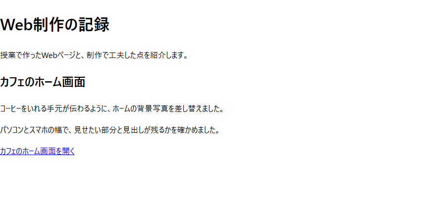

# DAY 10 伝える内容を決め、ベースを作る

<a id="day-10-スマホでボタンが押しにくい"></a>

[目次](../student-workbook.md) · [共通手順](./common.md#local-git-workflow) · [前の回：DAY 9](./day09.md) · [次の回：DAY 11](./day11.md)

> **先生からの課題**  
> 自分が作ったものや工夫したことを、初めて見る人に紹介するページを作りましょう。

**今回の課題:** 先生やクラスメートなど、見てほしい相手を一人決めます。  
教材の外に自分の`portfolio`を作り、そこに短い自己紹介と作業の説明を書きます。  
配布された教材はそのまま残します。  
紹介文がブラウザで読めて、必要なリンクが開けたら完成です。

**作業前に考えること:** 見る人に、自分のどんな工夫を知ってほしいですか。  
写真や画面を載せたいときは、使ってよいか確認します。

**今回学ぶこと:** HTMLで見出し・文章・リンクを書き、Gitで作業を記録します。

## 1. 紹介する内容を決める

**どこを見てもらう？** 作品のどこを見ると、自分の工夫が伝わりますか。  
「誰に見せるか」「自分で何を変えたか」「どう確かめたか」をメモします。

- **DAY 8の例**　営業時間を枠で囲み、スマホの幅でも読めるか見ました。
- **DAY 9の例**　ホームの背景を変え、スマホでもカップが見えるよう位置を調整しました。

DAY 8・9の成果が手元になければ、ほかの授業や自習で実際に取り組んだ作業を選びます。

## 2. 見出しと文章を書く

[共通の開始手順](./common.md#independent-day-start)で教材を更新します。  
[作品の初回準備](./common.md#portfolio-start)を見ながら、`Documents/portfolio`にひな型を用意します。  
VS Codeで`portfolio`フォルダーを開き、`index.html`を選びます。

1. `header`のコメントの位置に、ページ全体の見出しを`h1`で書きます。
2. その下に、短い自己紹介を`p`で書きます。
3. `main`の制作事例のコメントの位置に、作品名を`h2`で書きます。
4. その下に、自分が変えたことと確かめたことを`p`で書きます。
5. Ctrl+Sで保存し、ブラウザで`portfolio/index.html`を開きます。

## 3. 必要なら作品へのリンクを付ける

作品を見せたい場合は、載せてよいファイルを`portfolio/works/cafe/`などにコピーします。  
作品のHTMLと一緒に、使っているCSSや画像もコピーします。  
コピー先が`works/cafe/index.html`なら、次のように書けます。

```html
<p><a href="works/cafe/index.html">カフェのホーム画面を開く</a></p>
```



**作例のどこを見る？** ページ全体の題名と、紹介する作品の名前は、それぞれどこにありますか。  
どの一文を読むと、作った人が工夫したことが分かりますか。

**確認項目:** 自分のページを保存して、ブラウザで再読み込みします。  
初めて見る人は、見出しを読むだけで何を紹介するページか分かりますか。  
リンクを付けた場合、押すと見せたかった作品が開きますか。

💡 **ヒント：**
> `href`には、今のHTMLからリンク先までの道順を書きます。  
> DAY 8のフォームを紹介するなら、練習用サーバーで送信を確かめた結果を文章や画像で見せられます。

## 4. 保存して次回につなぐ

[作品を記録する手順](./common.md#day1015同じ作品を記録して続ける)に沿って、VS Codeの「ソース管理」で変更を見て、作品をコミットします。  
**作業メモ:** 見る相手、変えた所、確かめた結果、次に直す所、コミットの番号（SHA）を書きます。  
[共通のPR提出手順](./common.md#submission-policy)に沿って提出します。  
DAY 11では同じ作品を開いて続けます。

## 完成チェック

**入力:** 紹介する作業のメモとHTMLのひな型です。

**完成物:** 自己紹介と作業の説明を書いたページです。

**完成条件:**

- 誰に何を伝えるページかを言える。
- 自分で行った作業を説明し、ブラウザで読めることを確かめた。
- リンクを付けた場合は、実際に開いて表示を確かめた。
- 作品をGitで記録し、確かめた結果と次に直す所をメモした。

**証拠:** ブラウザの画面、Gitの差分、作業メモです。

**発展課題:** スマホの幅やキーボード操作を試し、気づいた点を一つ直します。  
装飾、相互レビュー、外部公開、発表は必須にしません。  
表示を調整するときは[旧DAY10の技術資料](../legacy-workbook/day10.md)を参考にできます。
